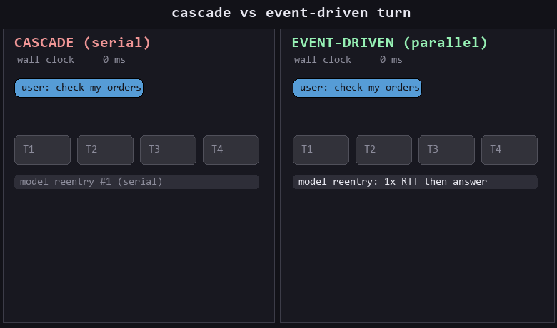

# Event-Driven Voice Orchestrator

**S2S-duplex turn-taking STRUCTURE for cascaded voice agents: background tools,
non-stalling user turns, generation and delivery as independent lifecycles —
~600 lines, zero dependencies, runs with a fake model, no API keys.**



*Same turn, both topologies, animated from real bench timings (RTT=1000ms, 4 tools,
canonical cell of `bench/bench_turn_latency.py`): cascade serializes the tool
round-trips — 4250ms — while the event-driven runtime dispatches them in parallel
(1125ms) and acks the mid-pending user turn at 0ms. Regenerate: `python tools/make_timeline_gif.py`.*

Part of [iamdgarcia](https://github.com/iamdgarcia)'s realtime voice-agent work.
Full writeup: [Watching your voice agent think](https://iamdgarcia.medium.com/watching-your-voice-agent-think-three-instruments-you-can-open-in-a-browser-tab-f7ed16ec2a2a).

---

A cascaded voice pipeline (ASR → LLM → TTS) serializes every step: a tool call
stops the world, a user turn during that wait is *lost time*, and a barge-in
tangles generation with playback. Full-duplex speech-to-speech models solve
this at the token level — but most production stacks can't buy that leap.

This library buys the **structure** of duplex turn-taking without leaving the
cascade: an event loop over one canonical conversation state where tools run in
the background, user turns are never stalled, and "what the model generated"
and "what the user actually heard" are tracked as independent lifecycles.

```text
Audio or text
     |
     v
Inbound adapter (terminal / Pipecat / websocket)
     |
     v
ConversationOrchestrator ──── one canonical ConversationState
     |    event queue: UserTextReceived | ToolCallFinished |
     |                 OutputDelivery{Started,Completed,Interrupted}
     |
     ├─ generation task (streaming model)   ← interrupt() cancels ONLY this
     ├─ background ToolDispatcher (parallel) ← barge-in never touches this
     └─ delivery lifecycle (PENDING→PLAYING→COMPLETED/INTERRUPTED)
              ↑ interrupted delivery is injected as internal context next turn
                ("the user did NOT hear your last answer") — the heard/not-heard
                signal cascade pipelines lose
     |
     v
Ports: ModelPort · ToolRegistryPort · OutputPort · ConversationRepositoryPort
```

## The cascade→duplex argument

A cascade pays `(tools − 1) × RTT` because each tool round-trip re-serializes
the turn. An S2S duplex model keeps listening while tools run. The event loop
closes most of that gap in a cascade: tools dispatch in parallel (`1 × RTT`
total), user turns during pending are applied as events and acked immediately,
and generation cancels in ~0 ms on barge-in. What remains cascade-only is the
token-level interleave (talking WHILE listening) — that is honest scope, see
[limitations](#honest-limitations).

## Measured invariants

From `bench/bench_turn_latency.py` (real orchestrator, scripted model, simulated
tool RTT; medians of N=3 wall-clock runs; numbers from a run on 2026-10-13):

| rtt | tools | cascade total | event-driven total | turn-2 ack (mid-pending) |
|----:|------:|--------------:|-------------------:|-------------------------:|
| 100ms | 1  | 250ms  | 235ms  | — |
| 100ms | 4  | 703ms  | 281ms  | 0ms |
| 1000ms | 1 | 1125ms | 1125ms | — |
| 1000ms | 4 | **4250ms** | **1156ms** | 0ms |

Three invariants asserted on every bench run:

1. **Parallel beats cascade**, with the gap growing linearly in
   `(tools − 1) × RTT` (measured A−B = 3094ms vs predicted 3000ms @ 1s×4).
2. **Never worse at tools=1** (the event loop adds no serialization tax).
3. **Turn-ack bounded**: a user turn during pending gets its response in
   well under the tool RTT (0ms in the bench — the model acks from the
   pending-calls context injection, no tool stall).

The same invariants were verified against a corporate POC of this design with a
sweep of RTT ∈ {10, 100, 500, 1000, 2000}ms × tools ∈ {1, 2, 4} (32/32 checks):
results hold across the matrix, gap stays linear.

## Quickstart

```bash
python -m examples.terminal_demo --demo   # scripted demo, no typing, exits by itself
python -m examples.terminal_demo          # interactive: type while tools run (~1.5s RTT)
python -m bench.bench_turn_latency        # reproduce the invariant table
python -m tests.test_orchestrator         # plain-assert test suite
```

No installs, no API keys — Python ≥ 3.11, standard library only. Plug your real
stack by implementing the five ports in `src/eventorchestrator/domain/ports.py`
(the demo's fake model/tools show the shape; a Pipecat adapter maps frames to
events and reports playback back).

## Integrations

Optional adapters live in [`integrations/`](integrations/README.md):

- **Pipecat** (`pipecat_adapter/`) — `EventDrivenOrchestratorBridge`, a
  `FrameProcessor` that maps `TranscriptionFrame` → `send_text`, playback
  frames → delivery lifecycle, and streams assistant deltas as `LLMTextFrame`.
  Transport only: Pipecat keeps scheduling, the orchestrator keeps state.
  Works with the `ScriptedModel` (no LLM) — see the [wiring snippet](integrations/README.md#wiring-into-a-pipeline)
  and run `python integrations/pipecat_adapter/test_bridge.py`.

Dev extras (`pillow`, `pipecat-ai`, `ruff`) live in `requirements-dev.txt`; the
core has no dependencies.

## Why not LangGraph?

Graph orchestrations encode conversation flow as nodes and edges. Voice
conversations are *event streams*: user turns, tool completions, and playback
reports arrive in arbitrary interleavings, and any static topology either
serializes them or grows an edge per case. The event loop here has no topology —
just "apply event → maybe re-invoke model" — and the interesting policies
(cancellation, aggregation, prioritization) stay explicit at the edges instead
of hiding in graph state.

## Honest limitations

- **No token-level duplex**: the model still speaks after it listens; the
  runtime overlaps transport and tools, not phonemes. True duplex needs an S2S
  model or a barge-in-capable streaming policy on top.
- **Dispatched tools are not cancelable**: once dispatched, a tool runs to
  completion (correct for side-effectful actions; wrong for speculative ones).
  Add an explicit policy port for invalidation/aggregation.
- **No backpressure**: a burst of user turns triggers one model invocation per
  turn (plus drains). Fine for demos/benches; gate it for production.
- The prefix-match duplicate suppression of the original internal POC was
  **removed** in this clean version (it could swallow legitimate answers with
  identical openings); visible emission is now single-source (see
  `tests/test_orchestrator.py::scenario_no_prefix_dedup`).

## Attribution

Designed by Daniel García ([@iamdgarcia](https://github.com/iamdgarcia)) —
realtime voice agent engineering. Clean-room reimplementation of a production
POC (same architecture, generic domain). Read the essay:
[Watching your voice agent think](https://iamdgarcia.medium.com/watching-your-voice-agent-think-three-instruments-you-can-open-in-a-browser-tab-f7ed16ec2a2a).

MIT licensed — see [LICENSE](LICENSE).
